# Sistema de Gestão de Extintores e Hidrantes

Aplicação web responsiva para apoiar a equipe de bombeiros de uma empresa no controle de extintores
e hidrantes. O bombeiro registra a inspeção pelo celular (**conforme** ou **não conforme**) e qualquer
funcionário, ao escanear o **QR Code**, vê a situação do equipamento e pode comunicar um problema.

> Sistema em uso em ambiente industrial. Este repositório é só de **apresentação**: as telas abaixo
> são de um ambiente de demonstração, com **dados fictícios**. O código-fonte fica em repositório
> privado.

## Como funciona

| Perfil | O que faz |
| --- | --- |
| **Funcionário** (sem login) | Escaneia o QR Code, consulta o equipamento pela tag da etiqueta, vê se está conforme e a data da última inspeção, e comunica um problema por texto. |
| **Bombeiro** | Registra a inspeção pelo celular (conforme / não conforme); o sistema grava a data, a hora e quem inspecionou. Recebe as comunicações dos funcionários e acompanha cada ocorrência até a solução. |
| **Bombeiro Master** | Cadastra setores, locais, extintores, hidrantes e bombeiros; anula registros feitos por engano; acompanha os números gerais. |

Fluxo: **QR Code → consulta / comunicação do funcionário → ocorrência → atendimento → resolvida**.

## Telas

### Funcionário pelo QR Code (celular, sem login)

<table>
  <tr>
    <td align="center">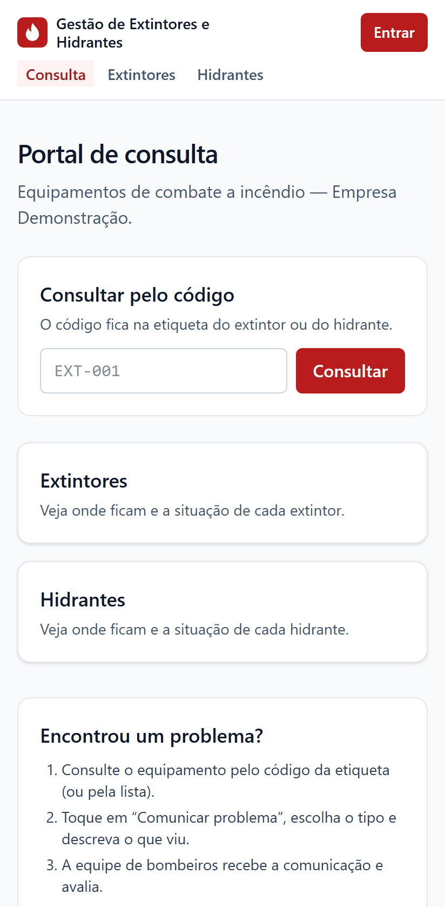 Portal do QR Code</td>
    <td align="center">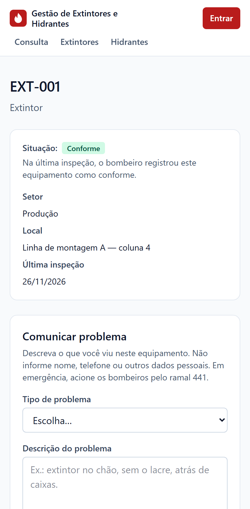 Extintor conforme</td>
    <td align="center">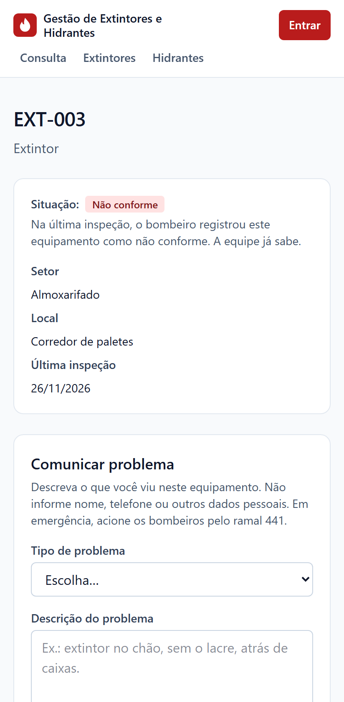 Extintor não conforme</td>
    <td align="center">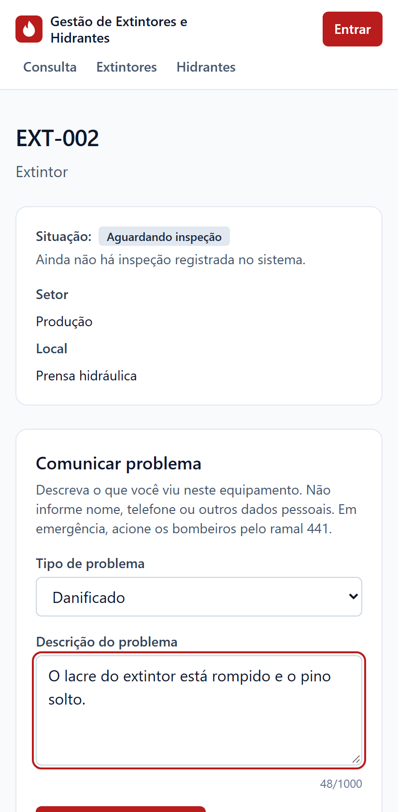 Comunicar problema</td>
  </tr>
</table>

### Bombeiro (celular)

<table>
  <tr>
    <td align="center">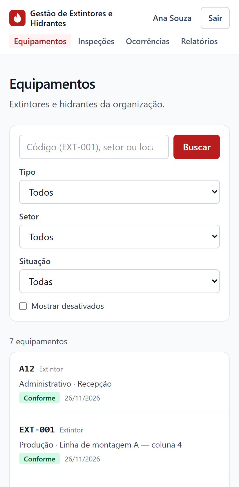 Equipamentos</td>
    <td align="center">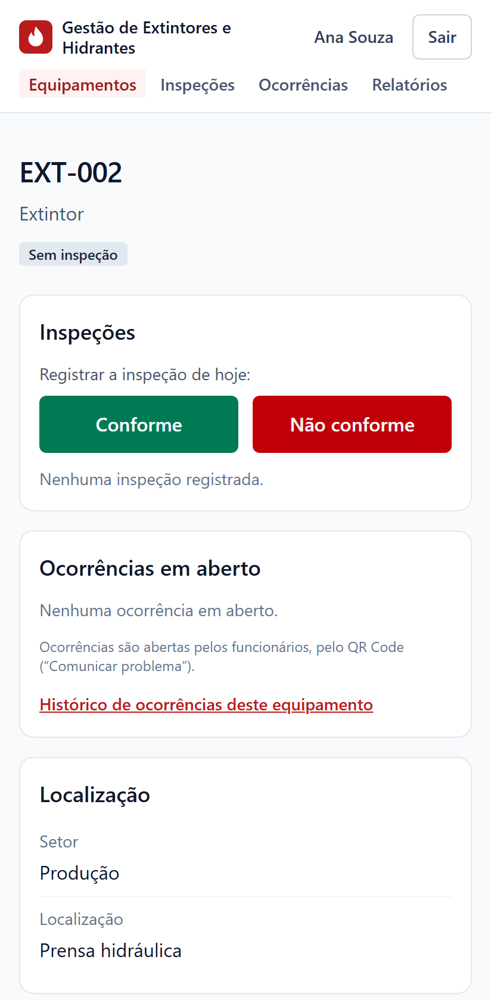 Conforme / Não conforme</td>
    <td align="center">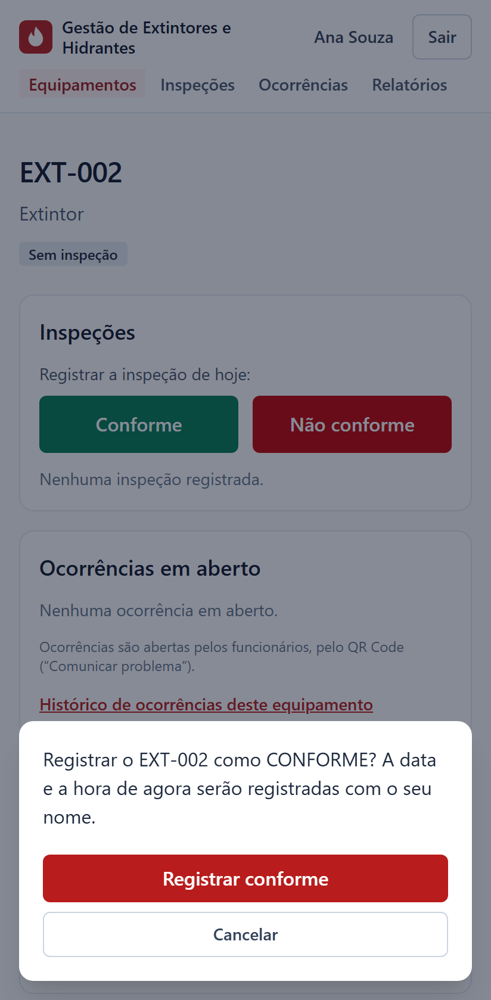 Confirmação</td>
    <td align="center">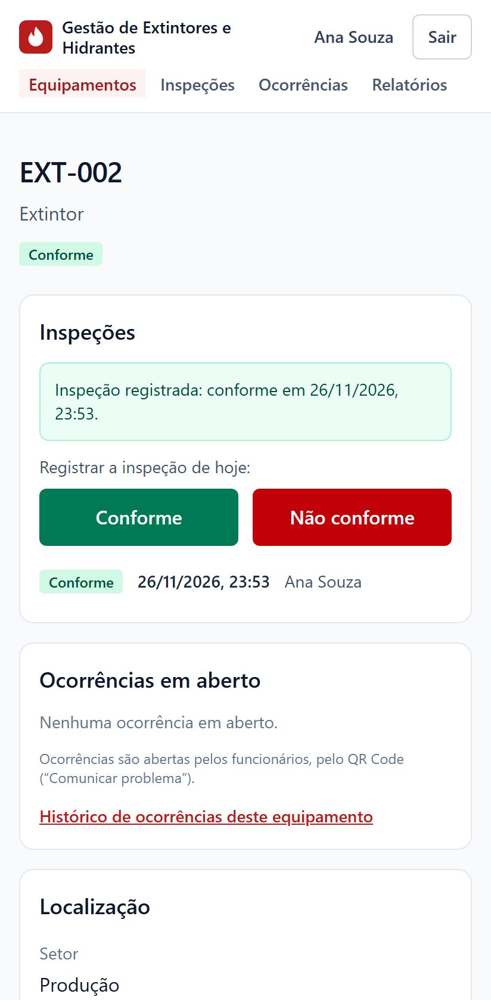 Inspeção registrada</td>
  </tr>
  <tr>
    <td align="center">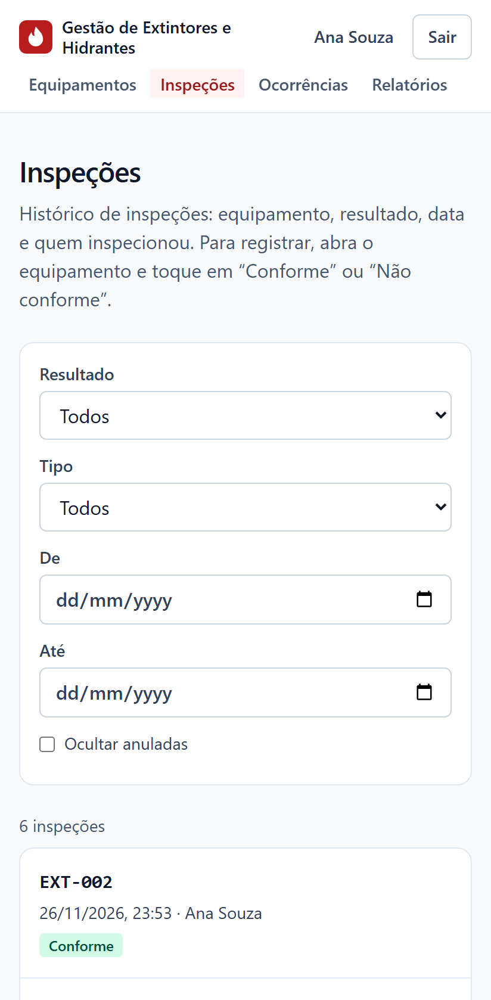 Histórico de inspeções</td>
    <td align="center">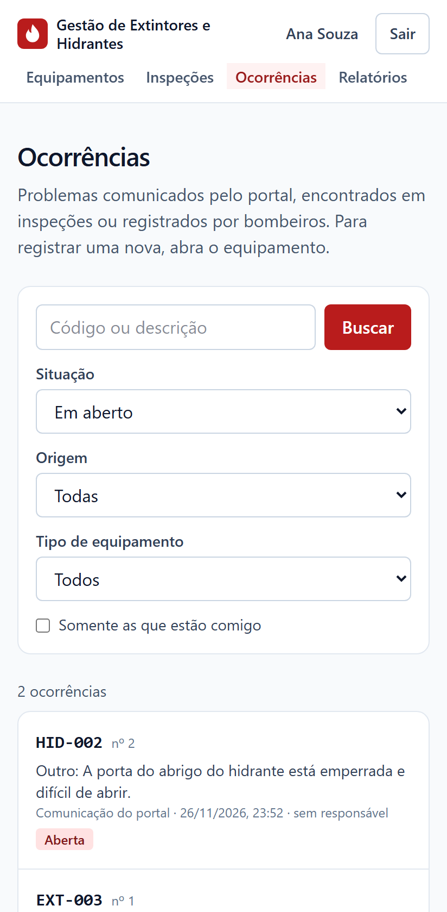 Ocorrências</td>
    <td align="center">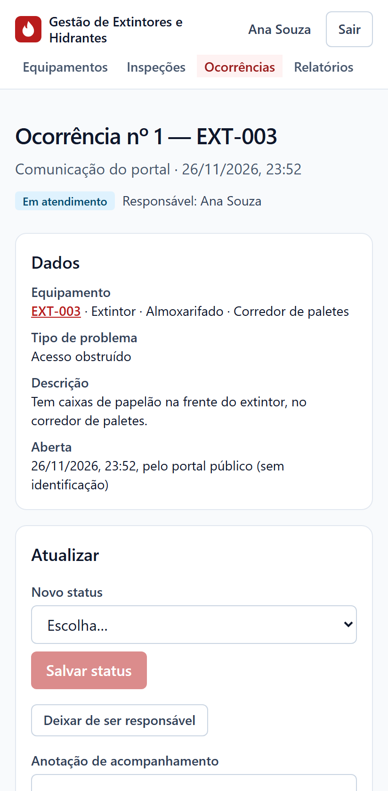 Acompanhamento</td>
    <td></td>
  </tr>
</table>

### Bombeiro Master (celular)

<table>
  <tr>
    <td align="center">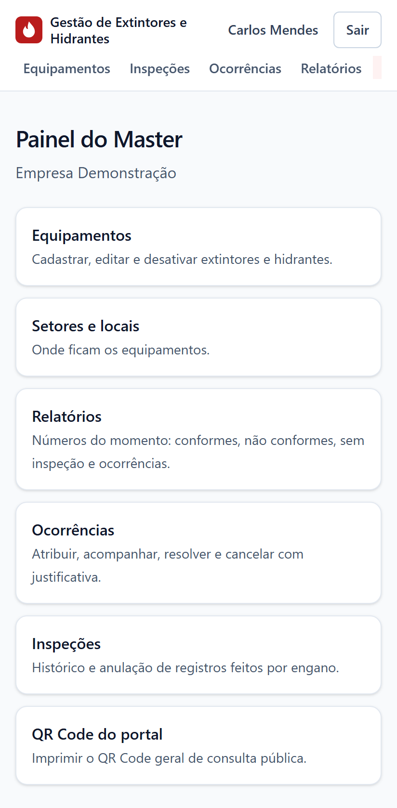 Painel do Master</td>
    <td align="center">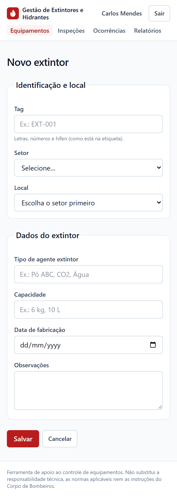 Cadastro de extintor</td>
    <td align="center">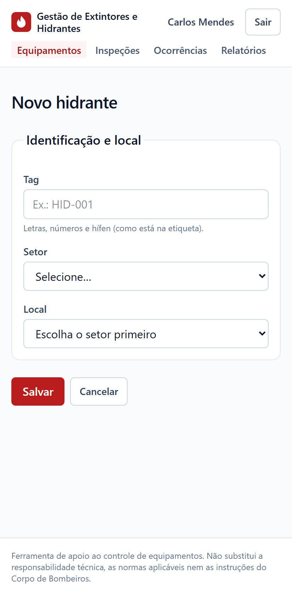 Cadastro de hidrante</td>
  </tr>
</table>

### Computador

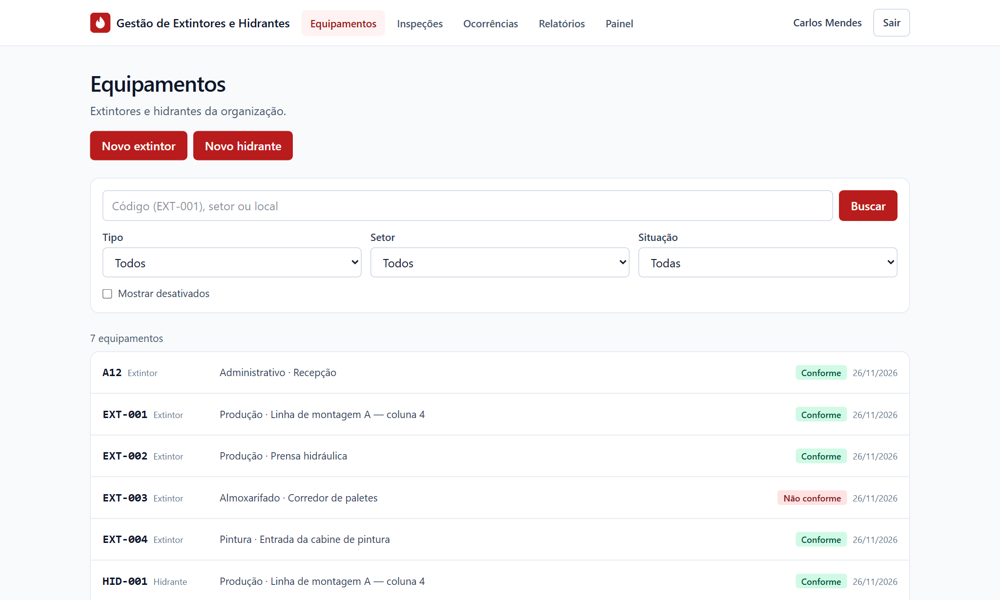

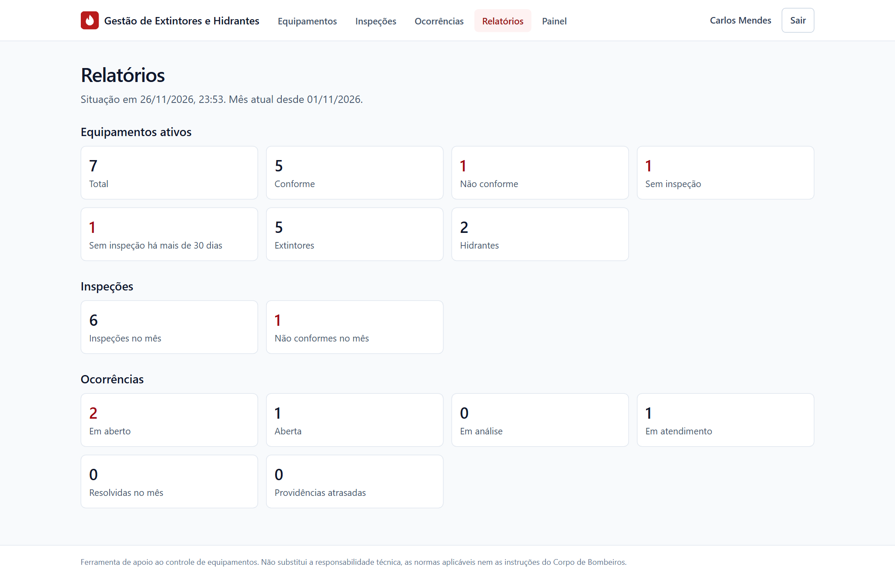

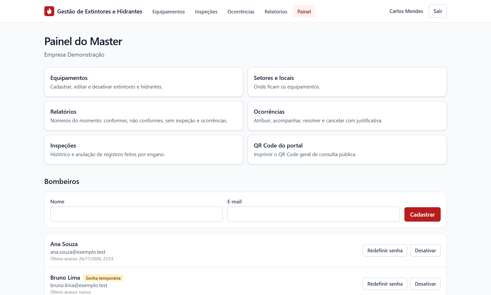

## Destaques

- **Inspeção em um toque:** botões Conforme / Não conforme, com confirmação; data e hora vêm do
  servidor, não do aparelho.
- **QR Code único** para a empresa: o funcionário digita a tag da etiqueta (letras e números) e vê a
  situação, sem precisar de login.
- **Ocorrências** abertas só pelos funcionários, pelo QR Code: a equipe assume, registra providências
  com prazo e resolve, com histórico completo.
- **Acesso por perfil**, login individual, senha temporária no primeiro acesso e registro (auditoria)
  de todas as operações.
- **Funciona no celular e no computador**, sem instalar aplicativo.
- **Qualidade:** testes automatizados de unidade, API e navegador (computador e celular), verificação
  de acessibilidade, backup do banco verificado por restauração.
- **Hospedagem na nuvem sem custo** (plano gratuito).

## Tecnologias

React · TypeScript · Vite · Tailwind CSS · React Router · Cloudflare Pages e Workers (API) ·
Cloudflare D1 (banco SQL) · Vitest · Playwright · axe-core

---

Desenvolvido por **Lucas Alencar**.
